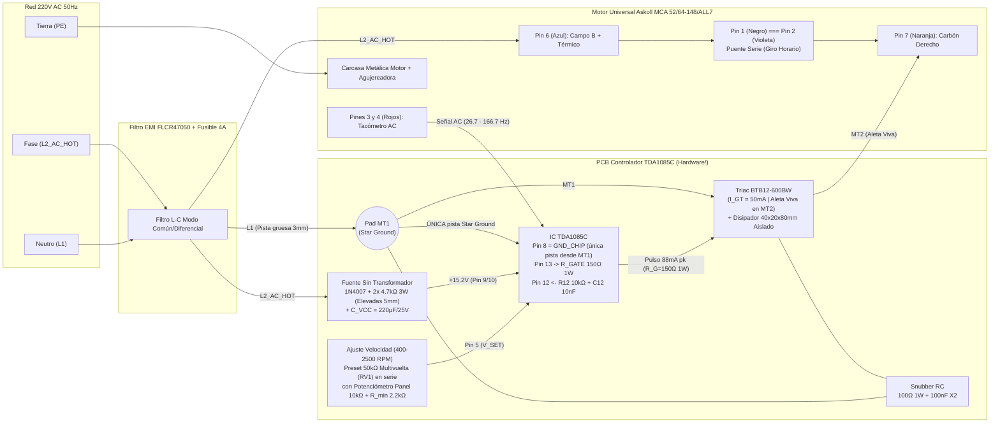

# Controlador de Velocidad a Lazo Cerrado (`TDA1085C`) para Agujereadora de Banco — Acople Directo

[](#)
[](Hardware/TDA1085C_Controller/)
[](Simulations/)

Proyecto de **Hardware Libre** para el diseño electrónico, simulación SPICE (**LTspice**) y diseño de circuito impreso (**KiCad**) de un controlador de velocidad a lazo cerrado proporcional-integral (PI) por ángulo de fase basado en el circuito integrado **`TDA1085C`**, destinado a adaptar un motor universal de lavarropas (**Askoll C.E.SET. `MCA 52/64-148/ALL7`**) en una **agujereadora de banco de acople directo** (regulando entre **$400\text{ RPM}$ y $2.500\text{ RPM}$** con alto torque a bajas vueltas).

---

> [!CAUTION]
> ### ⚠️ ADVERTENCIA DE SEGURIDAD ELÉCTRICA VITAL: TRIAC `BTB12-600BW` (ALETA NO AISLADA) Y CHASIS VIVO
> 1. **Aleta Metálica Viva ($220\text{ V AC}$):** Este diseño reutiliza un Triac **`BTB12-600BW`**. A diferencia de la serie `BTA` (aislada internamente), la sigla **`BTB`** indica que **la aleta metálica del encapsulado TO-220 está conectada internamente de forma directa al terminal `MT2` (`A2`)**. En consecuencia, **todo el disipador de aluminio extruido ($4 \times 2 \times 8\text{ cm}$) se encuentra permanentemente electrificado a potencial de red de $220\text{ V AC}$**.
> 2. **Prohibición de Contacto con el Chasis:** El disipador **JAMÁS debe tocar el chasis metálico** de la agujereadora de banco ni ningún elemento accesible al operador. Debe montarse rígidamente soportado sobre el PCB dentro de un gabinete plástico aislante cerrado, o bien aislar el TO-220 mediante **lámina de Mica/Kapton + grasa térmica siliconada + niple pasamuros aislante (bushing plástico) en el tornillo M3**, verificando aislación ($> 20\text{ M}\Omega$) con multímetro antes de conectar a la red.
> 3. **Masa de Control Sin Aislación Galvánica (`GND_CHIP`):** El circuito integrado `TDA1085C` opera referenciado directamente al polo `L1` (Neutro) de la línea de $220\text{ V AC}$. El eje del potenciómetro de panel debe ser plástico o contar con perilla aislante, y cualquier medición con osciloscopio requiere transformador de aislación o sondas diferenciales.
> 4. **Puesta a Tierra Obligatoria (`PE`):** El bastidor metálico de la agujereadora y la carcasa del motor deben conectarse obligatoriamente al conductor de **Tierra de Protección (`PE` Verde/Amarillo)** de la instalación eléctrica bajo interruptor diferencial ($30\text{ mA}$).

---

## 1. Estructura del Repositorio

```text
.
├── Docs/                                   # Documentación técnica, relevamiento fotográfico y cálculos
│   ├── Calculos_y_Notas_Diseno.md          # Memoria de cálculo detallada (Gate, F/V, 400-2500 RPM, térmica)
│   ├── TDA1085C-D.PDF                      # Hoja de datos oficial ON Semiconductor TDA1085C
│   ├── BTA12.PDF                           # Hoja de datos oficial STMicroelectronics BTA12 / BTB12-600BW
│   ├── conector.jpg                        # Relevamiento de bornera de 7 pines del motor Askoll
│   ├── filtro emi.jpg                      # Filtro EMI pasivo de entrada FLCR47050 (16A)
│   ├── placadearriba.jpg                   # Vista superior placa donante E.G.O.
│   └── placadeabajo.jpg                    # Vista inferior placa donante E.G.O.
├── Hardware/                               # Diseño de esquemático, PCB y fabricación en KiCad 10
│   ├── TDA1085C_Controller/
│   │   ├── TDA1085C_Controller.kicad_pro   # Proyecto KiCad con Netclasses (HV_AC clearance 3.0mm)
│   │   ├── TDA1085C_Controller.kicad_sch   # Esquemático completo del controlador TDA1085C
│   │   ├── TDA1085C_Controller.kicad_pcb   # Layout PCB (Star Ground en MT1 + barrera > 3.0mm)
│   │   ├── TDA1085C_Controller.kicad_dru   # Reglas DRC personalizadas de alta tensión y potencia
│   │   ├── fp-lib-table                    # Tabla de librería de huellas locales del proyecto
│   │   └── TDA1085C_Custom.pretty/         # Footprints dedicados (R 3W elevada pad 2.5/1.2mm y BTB12+Disipador)
│   ├── Fabrication/                        # Vistas previas exportadas listas para revisión/impresión
│   │   ├── Esquematico_TDA1085C.pdf        # Esquemático en PDF
│   │   ├── TDA1085C_Controller.svg         # Esquemático vectorial SVG
│   │   ├── PCB_TDA1085C_Preview.pdf        # Layout PCB en PDF
│   │   └── PCB_TDA1085C_Preview.svg        # Layout PCB vectorial SVG
│   └── BOM_KiCad.csv                       # Lista de materiales exportada desde KiCad
├── Simulations/                            # Simulaciones SPICE verificadas en LTspice 26.1
│   ├── tda1085c_controlador_completo_btb12.asc  # Esquemático maestro actualizado (BTB12-600BW, R_G=150R, C_VCC=220uF)
│   ├── tda1085c_controlador_completo_btb12.net  # Netlist SPICE ejecutable del modelo completo
│   ├── tda1085c_controlador_completo_btb12.log  # Resultados medidos (.meas) de simulación
│   ├── etapa1a_fuente_tda1085c.asc              # Análisis de fuente sin transformador y estrés de carga
│   ├── etapa1b_conversor_fv_tacho.asc           # Análisis del conversor F/V y escalado 400-2500 RPM
│   └── etapa1c_triac_snubber_motor.asc          # Análisis de conmutación inductiva, Snubber y dV/dt
├── .gitignore                              # Reglas de exclusión estándar para KiCad y LTspice
├── init_repo.sh                            # Script Bash de inicialización y estructuración Git
└── README.md                               # Documentación principal del proyecto
```

---

## 2. Especificaciones de Hardware y Diagramas de Conexión

### A. Motor Universal (`Askoll C.E.SET. MCA 52/64-148/ALL7`)
* **Datos nominales:** $220\text{–}240\text{ V AC}$, $50\text{ Hz}$ | $1.5\text{ A}$ | $330\text{ W}$ (entrada) | $11.000\text{ RPM}$ (régimen nominal lavarropas).
* **Rango de Operación en Agujereadora (Acople Directo):** **$400\text{ RPM}$ a $2.500\text{ RPM}$** para el $100\%$ del giro del potenciómetro de panel.
* **Parámetros eléctricos equivalentes (Serie):** $R_{\text{tot}} \approx 5.2\text{ }\Omega$, $L_{\text{tot}} \approx 22\text{ mH}$, tacómetro AC de $8$ polos ($60\text{–}180\text{ }\Omega$, $\approx 2.5\text{ Vrms} / 1.000\text{ RPM}$).

#### Mapeo de la Bornera de 7 Pines (Conexión Serie — Giro Horario)

| Pin Bornera | Color de Cable (Ficha Superior) | Componente Interno | Conexión en el Controlador |
| :---: | :--- | :--- | :--- |
| **Pin 1** | **Negro** | Extremo A del Campo (Estator) | **Puenteado con Pin 2** (une Campo y Rotor en serie) |
| **Pin 2** | **Violeta** | Carbón Izquierdo (Rotor) | **Puenteado con Pin 1** |
| **Pin 3** | **Rojo fino** | Generador Tacométrico (A) | Entrada `TACHO_AC` (`J3` Pin 1 $\rightarrow R_{12} = 10\text{ k}\Omega$) |
| **Pin 4** | **Rojo fino** | Generador Tacométrico (B) | Masa de control `GND_CHIP` (`J3` Pin 2) |
| **Pin 5** | **Gris** | Tap intermedio de campo | **No se usa** (dejar aislado) |
| **Pin 6** | **Azul** | Extremo B del Campo + Protector Térmico | Línea `L2_AC_HOT` ($220\text{ V AC}$ Fase filtrada, `J1` Pin 3) |
| **Pin 7** | **Naranja** | Carbón Derecho (Rotor) | Salida conmutada `MT2` del Triac (`J1` Pin 2) |

### B. Diagrama de Bloques y Cableado General



### C. Relevamiento Fotográfico del Hardware
| Motor y Bornera (`Docs/conector.jpg`) | Filtro EMI (`Docs/filtro emi.jpg`) | Placa Superior (`Docs/placadearriba.jpg`) | Placa Inferior (`Docs/placadeabajo.jpg`) |
| :---: | :---: | :---: | :---: |
|  |  |  |  |

---

## 3. Decisiones de Ingeniería y Ajustes del `TDA1085C`

1. **Etapa de Disparo de Gate para `BTB12-600BW` ($I_{GT} = 50\text{ mA}$):**
   * Al tratarse de un Triac **Snubberless (`BW`)** de $50\text{ mA}$ de sensibilidad de compuerta, se dimensionó **`R_GATE1` en $150\text{ }\Omega\text{ (1 W)}$** (rango admisible $120\text{ }\Omega\text{ a }150\text{ }\Omega$) entre el Pin 13 y el Gate.
   * En simulación ([`tda1085c_controlador_completo_btb12.log`](Simulations/tda1085c_controlador_completo_btb12.log)), el pulso de corriente alcanza **$87.9\text{ mA}$ pico** ($1.76 \times I_{GT}$), garantizando el encendido en el primer pulso en los cuadrantes I y III sin fallas a bajas temperaturas.
   * Para sostener esta corriente impulsiva sin caída de tensión en la lógica, el filtro principal **`C_VCC1`** en los pines 9/10 se fijó en **$220\text{ }\mu\text{F} / 25\text{ V}$** (con huella de $10\text{ mm}$ compatible también con **$470\text{ }\mu\text{F} / 25\text{ V}$**), logrando una tensión regulada de **$15.24\text{ V}$** con $0.43\text{ Vpp}$ de rizado.
2. **Escalado de Velocidad ($400\text{ RPM}$ a $2.500\text{ RPM}$) y Calibración Fina:**
   * La bomba de carga en el Pin 11 utiliza **`C11` de $470\text{ pF}$ a $1\text{ nF}$** (polipropileno/NP0) junto con $R_{11} = 470\text{ k}\Omega$ a $+V_{CC}$ y el integrador del Pin 4 ($R_4 = 270\text{ k}\Omega \parallel C_4 = 470\text{ nF}$), generando **$3.07\text{ V}$** (con $470\text{ pF}$) o **$5.14\text{ V}$** (con $1\text{ nF}$) a la velocidad tope de $2.500\text{ RPM}$.
   * En serie con el extremo superior del potenciómetro de panel de $10\text{ k}\Omega$ (`J2`) se incorporó un **preset multivuelta de $50\text{ k}\Omega$ (`RV1`, Bourns 3296W)** hacia $+V_{CC}$ (Pin 9) y un resistor de piso **`R_MIN1` ($2.2\text{ k}\Omega$)** hacia `GND_CHIP` (Pin 8). Esto permite calibrar con exactitud en placa las **$2.500\text{ RPM}$ máximas** al $100\%$ del potenciómetro y mantener **$400\text{ RPM}$ mínimas** al $0\%$ del recorrido.
3. **Protección del Tacómetro y Red Snubber:**
   * Después de la resistencia limitadora $R_{12} = 10\text{ k}\Omega$ del tacómetro (Pin 12), se incluyó el capacitor cerámico **`C12` de $10\text{ nF}$** en paralelo a masa (`GND_CHIP`) para filtrar picos inductivos y ruido de escobillas ($f_c = 1.59\text{ kHz}$).
   * Pese a que el `BTB12-600BW` es Snubberless, el PCB conserva las huellas de la red Snubber RC (**`R_SNUB1` = $100\text{ }\Omega\text{ 1 W}$ + `C_SNUB1` = $100\text{ nF 400 V X2}$**) en paralelo entre `MT1` y `MT2` para amortiguar el chispazo del colector del motor universal.

---

## 4. Reglas Críticas de Diseño PCB (DRC) Implementadas en KiCad

El diseño en [`Hardware/TDA1085C_Controller/`](Hardware/TDA1085C_Controller/) incorpora cuatro reglas de diseño físico obligatorias:

1. **Clearance de Alta Tensión ($> 3.0\text{ mm}$):** La clase de red `HV_AC` (`L2_AC_HOT`, `MT2`, `N_RECT`, `N_DROP_MID`, `N_SNUB`) está físicamente segregada en la mitad izquierda del PCB, separada por una **barrera de aislación libre de cobre $> 3.5\text{ mm}$** (definida en [`TDA1085C_Controller.kicad_pro`](Hardware/TDA1085C_Controller/TDA1085C_Controller.kicad_pro) y [`TDA1085C_Controller.kicad_dru`](Hardware/TDA1085C_Controller/TDA1085C_Controller.kicad_dru)) respecto a toda la sección lógica referenciada a `GND_CHIP`.
2. **Topología de Masa en Estrella (*Star Ground*):** El neutro de potencia `L1` ingresa desde la bornera `J1` por una pista de $3.0\text{ mm}$ de ancho directamente al pad **`MT1` (Pin 1)** del Triac `Q1`. **Desde ese pad `MT1` nace una única pista dedicada hacia el Pin 8 (`GND_CHIP`) del `TDA1085C`**, impidiendo que la corriente de $1.5\text{–}3.5\text{ A}$ del motor circule por debajo del integrado.
3. **Manejo Térmico de Resistencias de Caída ($2 \times 4.7\text{ k}\Omega\text{ 3 W}$):** Las resistencias `R_DROP1` y `R_DROP2` (que disipan $1.13\text{ W}$ cada una) utilizan el footprint dedicado [`R_Axial_3W_Elevated_Pad2.5mm_Drill1.2mm`](Hardware/TDA1085C_Controller/TDA1085C_Custom.pretty/R_Axial_3W_Elevated_Pad2.5mm_Drill1.2mm.kicad_mod) con **pads circulares de $2.5\text{ mm}$ y perforación de $1.2\text{ mm}$**, diseñadas para soldarse a **$5\text{ mm}$ de altura sobre el PCB** favoreciendo la convección natural de aire.
4. **Filtrado de Picos Inductivos en Tacómetro:** Huella de `C12` ($10\text{ nF}$ cerámico disco, paso $5.0\text{ mm}$) ubicada inmediatamente junto a la entrada del Pin 12 del `TDA1085C` tras `R12` ($10\text{ k}\Omega$).

---

## 5. Lista de Materiales Final (BOM)

También disponible en formato CSV para importación directa en [`Hardware/BOM_KiCad.csv`](Hardware/BOM_KiCad.csv).

| Referencia | Cant. | Valor / Especificación | Función en el Circuito | Encapsulado / Footprint KiCad | Notas de Montaje / Origen |
| :--- | :---: | :--- | :--- | :--- | :--- |
| **`U1`** | 1 | **`TDA1085C`** | Controlador de velocidad a lazo cerrado PI | `DIP-16_W7.62mm_Socket_LongPads` | Montar sobre zócalo DIP-16 torneado |
| **`Q1`** | 1 | **`BTB12-600BW`** | Triac $12\text{ A }600\text{ V}$ Snubberless ($I_{GT}=50\text{ mA}$) | `TO-220-3` + Disipador $40\times 20\times 80\text{ mm}$ | **Reutilizado. ¡ALETA VIVA EN MT2! Aislar del chasis** |
| **`D1`** | 1 | **`1N4007`** | Rectificador media onda ($1000\text{ V }1\text{ A}$) | `D_DO-41_SOD81_P10.16mm` | Fuente sin transformador |
| **`R_DROP1, R_DROP2`** | 2 | **$4.7\text{ k}\Omega\text{ / 3 W}$** | Caída de tensión AC a $+V_{CC}$ ($9.4\text{ k}\Omega$ total) | `R_Axial_3W_Elevated_Pad2.5mm_Drill1.2mm` | Metal Oxide (MOX). **Montar a $5\text{ mm}$ sobre el PCB** |
| **`R_GATE1`** | 1 | **$150\text{ }\Omega\text{ / 1 W}$** | Limitadora de pulso de Gate ($I_{G,\text{pk}} \approx 88\text{ mA}$) | `R_Axial_DIN0411_P12.70mm` | Admite $120\text{ }\Omega\text{ a }150\text{ }\Omega\text{ (1 W)}$ para $I_{GT}=50\text{ mA}$ |
| **`R_SNUB1`** | 1 | **$100\text{ }\Omega\text{ / 1 W}$** | Amortiguación red Snubber RC (`MT1-MT2`) | `R_Axial_DIN0411_P12.70mm` | Reutilizada de placa donante / MOX anti-inductiva |
| **`C_SNUB1`** | 1 | **$100\text{ nF / 400 V (275 Vac X2)}$** | Capacitor de seguridad red Snubber RC | `C_Rect_L18.0mm_W6.0mm_P15.00mm` | Polipropileno Clase X2 (reutilizado) |
| **`C_VCC1`** | 1 | **$220\text{ }\mu\text{F / 25 V}$** (o $470\text{ }\mu\text{F / 25 V}$) | Filtro electrolítico principal de $+V_{CC}$ (Pin 9/10) | `CP_Radial_D10.0mm_P5.00mm` | Sostiene picos de Gate de $50\text{–}90\text{ mA}$ ($105^\circ\text{C}$) |
| **`C_DEC1, C3, C5`** | 3 | **$100\text{ nF / 50 V}$** | Desacoplo $+V_{CC}$, filtro `I_LIM` (Pin 3) y `V_SET` (Pin 5) | `C_Disc_D5.0mm_W2.5mm_P5.00mm` | Cerámico multicapa / disco X7R |
| **`C12`** | 1 | **$10\text{ nF / 50 V}$** | Protección contra picos inductivos en Tacómetro (Pin 12) | `C_Disc_D5.0mm_W2.5mm_P5.00mm` | En paralelo tras $R_{12}$ hacia `GND_CHIP` |
| **`C11`** | 1 | **$470\text{ pF}$ a $1\text{ nF / 100 V}$** | Bomba de carga conversor F/V (Pin 11) | `C_Rect_L7.2mm_W3.5mm_P5.00mm` | Film polipropileno (FKP2/MKP2) o cerámico NP0/C0G |
| **`C4`** | 1 | **$470\text{ nF / 63 V}$** | Filtro integrador de velocidad real en Pin 4 | `C_Rect_L7.2mm_W3.5mm_P5.00mm` | Poliéster metalizado (MKS2) |
| **`C7`** | 1 | **$4.7\text{ }\mu\text{F / 50 V}$** | Rampa de arranque suave (*Soft-Start*, Pin 7) | `CP_Radial_D6.3mm_P2.50mm` | Electrolítico radial |
| **`C14`** | 1 | **$47\text{ nF / 63 V}$** | Generador diente de sierra $100\text{ Hz}$ (Pin 14) | `C_Rect_L7.2mm_W3.5mm_P5.00mm` | Poliéster metalizado (estable en temperatura) |
| **`C16`** | 1 | **$1\text{ }\mu\text{F / 50 V}$** | Compensación integral del lazo PI (Pin 16) | `CP_Radial_D6.3mm_P2.50mm` | Electrolítico o film en serie con `R16` |
| **`C17`** | 1 | **$47\text{ nF / 50 V}$** | Polo de alta frecuencia del lazo PI (Pin 16) | `C_Disc_D5.0mm_W2.5mm_P5.00mm` | Cerámico o film en paralelo a `GND_CHIP` |
| **`RV1`** | 1 | **Preset $50\text{ k}\Omega$ Multivuelta** | Calibración fina del tope de $2.500\text{ RPM}$ | `Potentiometer_Bourns_3296W_Vertical` | En serie con el potenciómetro de panel de $10\text{ k}\Omega$ |
| **`RV_PANEL` (Ext.)** | 1 | **Potenciómetro $10\text{ k}\Omega$ Lineal (B)** | Control manual de velocidad ($400\text{–}2.500\text{ RPM}$) | Conectado a `J2` (`PinHeader_1x03_P2.54mm`) | Montaje en panel con perilla plástica aislada |
| **`R_MIN1`** | 1 | **$2.2\text{ k}\Omega\text{ / 1/4 W}$** | Piso de consigna ($400\text{ RPM}$ al $0\%$ del potenciómetro) | `R_Axial_DIN0207_P10.16mm` | Evita que Pin 5 caiga debajo de $80\text{ mV}$ |
| **`R1, R2`** | 2 | **$820\text{ k}\Omega\text{ / 1/2 W}$** | Sincronismo de corriente (`MT2` $\rightarrow$ Pin 1) y tensión (`L2` $\rightarrow$ Pin 2) | `R_Axial_DIN0411_P12.70mm` | Cuerpo de alta tensión ($> 350\text{ V}$ de trabajo) |
| **`R3, R12`** | 2 | **$10\text{ k}\Omega\text{ / 1/4 W}$** | Referencia Pin 3 (`I_LIM`) y limitadora de Tacómetro (Pin 12) | `R_Axial_DIN0207_P10.16mm` | Película metálica $1\%$ |
| **`R4, R15`** | 2 | **$270\text{ k}\Omega\text{ / 1/4 W}$** | Ganancia F/V en Pin 4 y corriente de rampa en Pin 15 | `R_Axial_DIN0207_P10.16mm` | Película metálica $1\%$ (en `R4` admite $270\text{–}330\text{ k}\Omega$) |
| **`R11`** | 1 | **$470\text{ k}\Omega\text{ / 1/4 W}$** | Polarización bomba de carga Pin 11 hacia $+V_{CC}$ | `R_Axial_DIN0207_P10.16mm` | Película metálica $1\%$ |
| **`R16`** | 1 | **$47\text{ k}\Omega\text{ / 1/4 W}$** | Ganancia proporcional del compensador PI (Pin 16) | `R_Axial_DIN0207_P10.16mm` | Película metálica $1\%$ |
| **`J1`** | 1 | **Bornera 4 Polos ($5.08\text{ mm}$)** | Conexión de Red $220\text{ V AC}$ (`L1`, `L2`) y Motor (Pines 6 y 7) | `TerminalBlock_Phoenix_MKDS-3-4-5.08` | Corriente nominal $\ge 15\text{ A}$ ($300\text{ V}$) |
| **`J3`** | 1 | **Bornera 2 Polos ($5.08\text{ mm}$)** | Entrada del generador tacométrico (Pines 3 y 4 del motor) | `TerminalBlock_Phoenix_MKDS-1,5-2-5.08` | Cables rojos del tacómetro |
| **`J2`** | 1 | **Header 3 Pines ($2.54\text{ mm}$)** | Conector para potenciómetro de panel ($10\text{ k}\Omega$) | `PinHeader_1x03_P2.54mm_Vertical` | Pin 1: Tope (`RV1`), Pin 2: Cursor (Pin 5), Pin 3: Piso (`R_MIN1`) |
| **Filtro EMI (Ext.)** | 1 | **`FLCR47050` ($250\text{ V }16\text{ A}$)** | Filtro EMI de línea previo a la placa + Fusible $4\text{ A}$ | Montaje en chasis | Reutilizado del lavarropas donante |

---

## 6. Cómo Ejecutar las Simulaciones y Abrir el Proyecto KiCad

### En LTspice:
1. Abrir [`Simulations/tda1085c_controlador_completo_btb12.asc`](Simulations/tda1085c_controlador_completo_btb12.asc) en **LTspice**.
2. Presionar **Run** (`Alt+R`) y abrir el registro de mediciones con `Ctrl+L` ([`tda1085c_controlador_completo_btb12.log`](Simulations/tda1085c_controlador_completo_btb12.log)) para inspeccionar:
   * `vcc_avg = 15.24 V` ($\text{rizado } 0.43\text{ Vpp}$) con $C_{\text{VCC}} = 220\text{ }\mu\text{F}$.
   * `i_gate_pk_ma = 87.88 mA` sobre $R_G = 150\text{ }\Omega\text{ (1 W)}$ hacia el `BTB12-600BW`.
   * `vpin4_470p_2500rpm = 3.07 V` vs. `vpin4_1n_2500rpm = 5.14 V` a $2.500\text{ RPM}$.

### En KiCad 10.0:
1. Abrir [`Hardware/TDA1085C_Controller/TDA1085C_Controller.kicad_pro`](Hardware/TDA1085C_Controller/TDA1085C_Controller.kicad_pro).
2. Revisar el esquemático ([`TDA1085C_Controller.kicad_sch`](Hardware/TDA1085C_Controller/TDA1085C_Controller.kicad_sch)) y el diseño de PCB ([`TDA1085C_Controller.kicad_pcb`](Hardware/TDA1085C_Controller/TDA1085C_Controller.kicad_pcb)), donde ya se encuentran cargadas las huellas personalizadas de las resistencias de $3\text{ W}$ elevadas (`Pad 2.5mm / Drill 1.2mm`), el conjunto `BTB12-600BW` con disipador de $40\times 20\times 80\text{ mm}$, el ruteo *Star Ground* desde `MT1` y la barrera de aislación $> 3.0\text{ mm}$.
