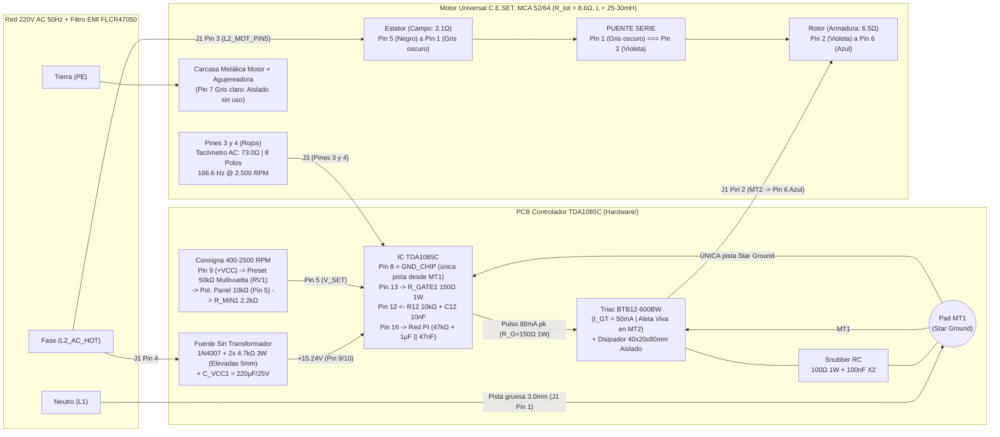
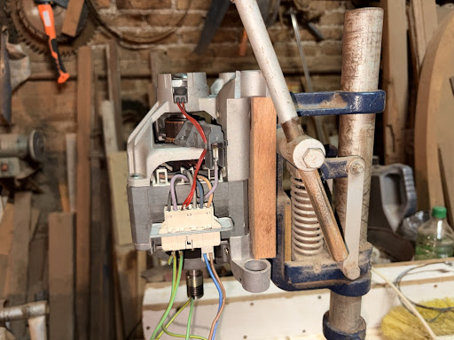
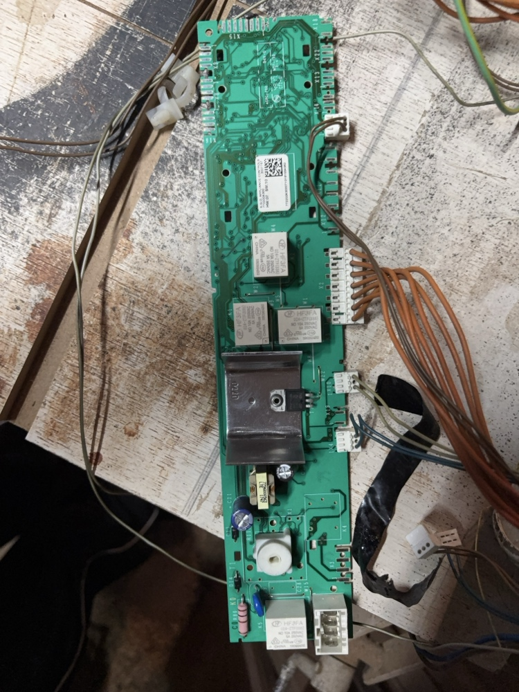
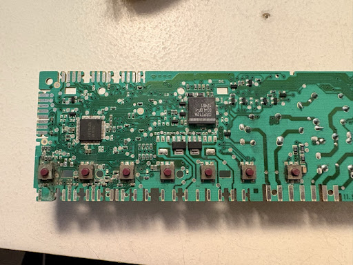

# Controlador de Velocidad a Lazo Cerrado (`TDA1085C`) para Agujereadora de Banco — Acople Directo

[](#)
[](Hardware/TDA1085C_Controller/)
[](Simulations/)

Proyecto de **Hardware Libre** para el diseño electrónico, simulación SPICE (**LTspice**) y diseño de circuito impreso (**KiCad**) de un controlador de velocidad a lazo cerrado proporcional-integral (PI) por ángulo de fase basado en el circuito integrado **`TDA1085C`**, destinado a adaptar un motor universal de lavarropas (**Askoll / C.E.SET. `MCA 52/64-148/ALL7`**) en una **agujereadora de banco de acople directo** (regulando entre **$400\text{ RPM}$ y $2.500\text{ RPM}$** con alto torque a bajas vueltas).

---

> [!CAUTION]
> ### ⚠️ ADVERTENCIA DE SEGURIDAD ELÉCTRICA VITAL: TRIAC `BTB12-600BW` (ALETA NO AISLADA) Y CHASIS VIVO
> 1. **Aleta Metálica Viva ($220\text{ V AC}$):** Este diseño reutiliza un Triac **`BTB12-600BW`**. A diferencia de la serie `BTA` (aislada internamente), la sigla **`BTB`** indica que **la aleta metálica del encapsulado TO-220 está conectada internamente de forma directa al terminal `MT2` (`A2`)**. En consecuencia, **todo el disipador de aluminio extruido ($4 \times 2 \times 8\text{ cm}$) se encuentra permanentemente electrificado a potencial de red de $220\text{ V AC}$**.
> 2. **Prohibición de Contacto con el Chasis:** El disipador **JAMÁS debe tocar el chasis metálico** de la agujereadora de banco ni ningún elemento accesible al operador. Debe montarse rígidamente soportado sobre el PCB dentro de un gabinete plástico aislante cerrado, o bien aislar el TO-220 mediante **lámina de Mica/Kapton + grasa térmica siliconada + niple pasamuros aislante (bushing plástico) en el tornillo M3**, verificando aislación ($> 20\text{ M}\Omega$) con multímetro antes de conectar a la red.
> 3. **Masa de Control Sin Aislación Galvánica (`GND_CHIP`):** El circuito integrado `TDA1085C` opera referenciado directamente al polo `L1` (Neutro) de la línea de $220\text{ V AC}$. El eje del potenciómetro de panel debe ser plástico o contar con perilla aislante, y cualquier medición con osciloscopio requiere transformador de aislación o sondas diferenciales.
> 4. **Puesta a Tierra Obligatoria (`PE`):** El bastidor metálico de la agujereadora y la carcasa del motor deben conectarse obligatoriamente al conductor de **Tierra de Protección (`PE` Verde/Amarillo)** de la instalación eléctrica bajo interruptor diferencial ($30\text{ mA}$).

---

## 1. Estructura del Repositorio

```text
.
├── Docs/                                   # Documentación técnica, relevamiento fotográfico y cálculos
│   ├── Calculos_y_Notas_Diseno.md          # Memoria de cálculo actualizada (Pinout real, R=8.6Ω, Tacho=73Ω, Lazo PI)
│   ├── TDA1085C-D.PDF                      # Hoja de datos oficial ON Semiconductor TDA1085C
│   ├── BTA12.PDF                           # Hoja de datos oficial STMicroelectronics BTA12 / BTB12-600BW
│   ├── conector.jpg                        # Relevamiento de bornera de 7 pines del motor C.E.SET.
│   ├── filtro emi.jpg                      # Filtro EMI pasivo de entrada FLCR47050 (16A)
│   ├── placadearriba.jpg                   # Vista superior placa donante E.G.O.
│   └── placadeabajo.jpg                    # Vista inferior placa donante E.G.O.
├── Hardware/                               # Diseño de esquemático, PCB y fabricación en KiCad 10
│   ├── TDA1085C_Controller/
│   │   ├── TDA1085C_Controller.kicad_pro   # Proyecto KiCad con Netclasses (HV_AC clearance 3.0mm)
│   │   ├── TDA1085C_Controller.kicad_sch   # Esquemático completo del controlador TDA1085C (Rev 2.1)
│   │   ├── TDA1085C_Controller.kicad_pcb   # Layout PCB (Star Ground en MT1 + barrera > 3.0mm)
│   │   ├── TDA1085C_Controller.kicad_dru   # Reglas DRC personalizadas de alta tensión y potencia
│   │   ├── fp-lib-table                    # Tabla de librería de huellas locales del proyecto
│   │   └── TDA1085C_Custom.pretty/         # Footprints dedicados (R 3W elevada pad 2.5/1.2mm y BTB12+Disipador)
│   ├── Fabrication/                        # Vistas previas exportadas listas para revisión/impresión
│   │   ├── Esquematico_TDA1085C.pdf        # Esquemático en PDF
│   │   ├── TDA1085C_Controller.svg         # Esquemático vectorial SVG
│   │   ├── PCB_TDA1085C_Preview.pdf        # Layout PCB en PDF
│   │   └── PCB_TDA1085C_Preview.svg        # Layout PCB vectorial SVG
│   └── BOM_KiCad.csv                       # Lista de materiales exportada desde KiCad + parámetros medidos
├── Simulations/                            # Simulaciones SPICE verificadas en LTspice 26.1
│   ├── etapa2_lazo_pi_conversor_fv.asc          # Modelo dinámico del Conversor F-V (Tacho 73Ω) y Lazo PI (Pin 16)
│   ├── etapa2_lazo_pi_conversor_fv.net          # Netlist SPICE del Conversor F-V y Lazo PI
│   ├── etapa2_lazo_pi_conversor_fv.log          # Mediciones del transitorio bajo carga del Lazo PI
│   ├── tda1085c_controlador_completo_btb12.asc  # Esquemático maestro completo (Estator 2.1Ω + Rotor 6.5Ω + BTB12)
│   ├── tda1085c_controlador_completo_btb12.net  # Netlist SPICE ejecutable del modelo completo
│   ├── tda1085c_controlador_completo_btb12.log  # Resultados medidos (.meas) del modelo maestro
│   ├── etapa1a_fuente_tda1085c.asc              # Análisis de fuente sin transformador y estrés de carga
│   ├── etapa1b_conversor_fv_tacho.asc           # Análisis del conversor F/V (400 RPM vs 2.500 RPM)
│   └── etapa1c_triac_snubber_motor.asc          # Análisis de conmutación inductiva, Snubber y dV/dt
├── .gitignore                              # Reglas de exclusión estándar para KiCad y LTspice
├── init_repo.sh                            # Script Bash de inicialización y estructuración Git
└── README.md                               # Documentación principal del proyecto
```

---

## 2. Parámetros Físicos Medidos y Pinout Definitivo del Motor

### A. Motor Universal (`Askoll / C.E.SET. MCA 52/64-148/ALL7`)
* **Datos nominales de placa:** $220\text{–}240\text{ V AC}$, $50\text{ Hz}$ | $1.5\text{ A}$ | $330\text{ W}$ (entrada) | $11.000\text{ RPM}$.
* **Rango de Operación en Agujereadora (Acople Directo):** **$400\text{ RPM}$ a $2.500\text{ RPM}$** para el $100\%$ del giro del potenciómetro de panel.
* **Parámetros de Potencia Medidos en Banco:**
  * **Resistencia del Estator (Campo):** $R_{\text{estator}} = \mathbf{2.1\text{ }\Omega}$ *(medida entre **Pin 1** y **Pin 5**)*.
  * **Resistencia del Rotor (Inducido / Armadura):** $R_{\text{rotor}} = \mathbf{6.5\text{ }\Omega}$ *(medida entre **Pin 2** y **Pin 6**)*.
  * **Resistencia Total en Serie (DC):** $R_{\text{total}} = R_{\text{estator}} + R_{\text{rotor}} = \mathbf{8.6\text{ }\Omega}$.
  * **Inductancia Total en Serie Estimada:** $L_{\text{total}} \approx \mathbf{25\text{ mH}\text{ a }30\text{ mH}}$ ($28\text{ mH}$ en simulación: $15\text{ mH}$ campo + $13\text{ mH}$ inducido).
* **Parámetros del Generador Tacométrico Medidos (Pines 3 y 4):**
  * **Polos Magnéticos:** **$8\text{ polos}$** ($4$ pares de polos $\rightarrow 4$ ciclos AC por revolución).
  * **Resistencia de la Bobina:** $R_{\text{tacho}} = \mathbf{73.0\text{ }\Omega}$.
  * **Frecuencia a $2.500\text{ RPM}$ (Tope deseado):** $f_{\text{max}} = \mathbf{166.6\text{ Hz}}$ ($f_{\text{min}} = 26.67\text{ Hz}$ a $400\text{ RPM}$).

### B. Pinout Definitivo de la Bornera de 7 Pines (de Izquierda a Derecha)

Se utiliza el mazo de cables inferior original que vincula los pines **1, 2, 5 y 6** para establecer la conexión en serie:

| Pin Bornera (Izq. $\rightarrow$ Der.) | Color de Cable | Bobinado / Elemento Interno | Conexión en el Controlador (`MOTOR_OUT` / `TACHO`) |
| :---: | :--- | :--- | :--- |
| **Pin 1** | **Gris oscuro** | **Estator (Campo A)** | **Puente Serie:** Unir directamente con **Pin 2 (Violeta)** |
| **Pin 2** | **Violeta** | **Rotor (Carbón Izquierdo)** | **Puente Serie:** Unir directamente con **Pin 1 (Gris oscuro)** |
| **Pin 3** | **Rojo fino** | **Generador Tacométrico ($73.0\text{ }\Omega$)** | Entrada `TACHO_AC` en Bornera `J3` Pin 1 ($\rightarrow R_{12} = 10\text{ k}\Omega$) |
| **Pin 4** | **Rojo fino** | **Generador Tacométrico ($73.0\text{ }\Omega$)** | Masa `GND_CHIP` en Bornera `J3` Pin 2 |
| **Pin 5** | **Negro** | **Estator (Campo B)** | **Alimentación (`MOTOR_OUT`):** Conectar a Bornera `J1` Pin 3 (`L2_AC_HOT`) |
| **Pin 6** | **Azul** | **Rotor (Carbón Derecho)** | **Alimentación (`MOTOR_OUT`):** Conectar a Bornera `J1` Pin 2 (`MT2` del Triac `BTB12-600BW`) |
| **Pin 7** | **Gris claro** | **Estator (Tap o Térmico interno)** | **Sin uso** en esta configuración (dejar aislado) |

### C. Diagrama de Conexión en Serie y Bloques del Controlador



### D. Relevamiento Fotográfico del Hardware
| Motor y Bornera (`Docs/conector.jpg`) | Filtro EMI (`Docs/filtro emi.jpg`) | Placa Superior (`Docs/placadearriba.jpg`) | Placa Inferior (`Docs/placadeabajo.jpg`) |
| :---: | :---: | :---: | :---: |
|  |  |  |  |

---

## 3. Simulaciones SPICE Actualizadas (`LTspice 26.1.1`)

| Esquemático (`.asc`) | Netlist (`.net`) | Resultados (`.log`) | Descripción |
| :--- | :--- | :--- | :--- |
| [`etapa2_lazo_pi_conversor_fv.asc`](Simulations/etapa2_lazo_pi_conversor_fv.asc) | [`etapa2_lazo_pi_conversor_fv.net`](Simulations/etapa2_lazo_pi_conversor_fv.net) | [`etapa2_lazo_pi_conversor_fv.log`](Simulations/etapa2_lazo_pi_conversor_fv.log) | **Conversor F/V y Lazo PI (Pines 12, 11, 4, 5 y 16):** Tacómetro real ($R_{\text{tacho}}=73.0\text{ }\Omega$, $8$ polos, $166.6\text{ Hz}$ a $2.500\text{ RPM}$), filtro $10\text{ k}\Omega + 10\text{ nF}$, bomba de carga $C_{11}=1\text{ nF}$, integrador $R_4=270\text{ k}\Omega \parallel 470\text{ nF}$ y respuesta dinámica del compensador PI ($47\text{ k}\Omega + 1\text{ }\mu\text{F} \parallel 47\text{ nF}$) ante escalón de carga de perforación. |
| [`tda1085c_controlador_completo_btb12.asc`](Simulations/tda1085c_controlador_completo_btb12.asc) | [`tda1085c_controlador_completo_btb12.net`](Simulations/tda1085c_controlador_completo_btb12.net) | [`tda1085c_controlador_completo_btb12.log`](Simulations/tda1085c_controlador_completo_btb12.log) | **Modelo Maestro Completo:** Fuente sin transformador ($2\times 4.7\text{ k}\Omega\text{ 3W} + 220\text{ }\mu\text{F}$), disparo de Gate ($150\text{ }\Omega\text{ 1W}$, $87.9\text{ mA pk}$), motor serie con Estator ($2.1\text{ }\Omega + 15\text{ mH}$) + Puente Pin 1–Pin 2 + Rotor ($6.5\text{ }\Omega + 13\text{ mH} + \text{FEM}$) y Triac `BTB12-600BW`. |
| [`etapa1a_fuente_tda1085c.asc`](Simulations/etapa1a_fuente_tda1085c.asc) | [`etapa1a_fuente_tda1085c.net`](Simulations/etapa1a_fuente_tda1085c.net) | [`etapa1a_fuente_tda1085c.log`](Simulations/etapa1a_fuente_tda1085c.log) | Evaluación térmica y de rizado de la fuente sin transformador. |
| [`etapa1b_conversor_fv_tacho.asc`](Simulations/etapa1b_conversor_fv_tacho.asc) | [`etapa1b_conversor_fv_tacho.net`](Simulations/etapa1b_conversor_fv_tacho.net) | [`etapa1b_conversor_fv_tacho.log`](Simulations/etapa1b_conversor_fv_tacho.log) | Comparativa del conversor F/V a $400\text{ RPM}$ ($26.67\text{ Hz}$) y $2.500\text{ RPM}$ ($166.6\text{ Hz}$) con $R_{\text{tacho}} = 73.0\text{ }\Omega$. |
| [`etapa1c_triac_snubber_motor.asc`](Simulations/etapa1c_triac_snubber_motor.asc) | [`etapa1c_triac_snubber_motor.net`](Simulations/etapa1c_triac_snubber_motor.net) | [`etapa1c_triac_snubber_motor.log`](Simulations/etapa1c_triac_snubber_motor.log) | Conmutación inductiva con $R_{\text{tot}} = 8.6\text{ }\Omega$ y $L_{\text{tot}} = 28\text{ mH}$. |

---

## 4. Reglas Críticas de Diseño PCB (DRC) en KiCad

1. **Clearance de Alta Tensión ($> 3.0\text{ mm}$):** Separación física $> 3.5\text{ mm}$ entre las pistas `HV_AC` (`L2_AC_HOT`, `MT2`) y toda la sección lógica referenciada a `GND_CHIP`.
2. **Topología de Masa en Estrella (*Star Ground*):** La pista gruesa de `L1` ($220\text{ V}$) entra al pad `MT1` del Triac `Q1`. Desde ese pad sale **UNA ÚNICA pista** hacia el Pin 8 del `TDA1085C`, evitando bucles de corriente de armadura bajo el integrado.
3. **Manejo Térmico en PCB:** Las dos resistencias de caída ($4.7\text{ k}\Omega\text{ 3 W}$) cuentan con pads de **$2.5\text{ mm}$ (agujero $1.2\text{ mm}$)** en [`R_Axial_3W_Elevated_Pad2.5mm_Drill1.2mm.kicad_mod`](Hardware/TDA1085C_Controller/TDA1085C_Custom.pretty/R_Axial_3W_Elevated_Pad2.5mm_Drill1.2mm.kicad_mod) para ser montadas a **$5\text{ mm}$ de altura sobre el PCB**.
4. **Protección del Tacómetro:** Huella para el capacitor cerámico `C12` ($10\text{ nF}$) en paralelo con la entrada del Pin 12 (después de `R12` = $10\text{ k}\Omega$) para absorber picos inductivos.

---

## 5. Lista de Materiales Definitiva (BOM)

Sincronizada con [`Hardware/BOM_KiCad.csv`](Hardware/BOM_KiCad.csv):

| Referencia | Cant. | Valor / Especificación | Función en el Circuito | Footprint KiCad | Notas de Montaje / Parámetros |
| :--- | :---: | :--- | :--- | :--- | :--- |
| **`U1`** | 1 | **`TDA1085C`** | Controlador de velocidad a lazo cerrado PI | `Package_DIP:DIP-16_W7.62mm_Socket_LongPads` | Montar sobre zócalo DIP-16 |
| **`Q1`** | 1 | **`BTB12-600BW`** | Triac $12\text{ A }600\text{ V}$ Snubberless ($I_{GT}=50\text{ mA}$) | `TDA1085C_Custom:BTB12-600BW_Heatsink_40x20x80mm_LIVE_TAB` | **¡ALETA VIVA EN MT2! Aislar del chasis** |
| **`D1`** | 1 | **`1N4007`** | Rectificador de media onda ($1000\text{ V }1\text{ A}$) | `Diode_THT:D_DO-41_SOD81_P10.16mm_Horizontal` | Fuente sin transformador |
| **`R_DROP1, R_DROP2`** | 2 | **$4.7\text{ k}\Omega\text{ / 3 W}$** | Caída de tensión AC a $+V_{CC}$ ($9.4\text{ k}\Omega$ serie) | `TDA1085C_Custom:R_Axial_3W_Elevated_Pad2.5mm_Drill1.2mm` | MOX. **Montar a $5\text{ mm}$ sobre el PCB** |
| **`R_GATE1`** | 1 | **$150\text{ }\Omega\text{ / 1 W}$** | Limitadora de pulso de Gate ($88\text{ mA pk}$) | `Resistor_THT:R_Axial_DIN0411_L9.9mm_D3.6mm_P12.70mm_Horizontal` | Garantiza disparo para $I_{GT}=50\text{ mA}$ |
| **`R_SNUB1`** | 1 | **$100\text{ }\Omega\text{ / 1 W}$** | Amortiguación red Snubber RC (`MT1-MT2`) | `Resistor_THT:R_Axial_DIN0411_L9.9mm_D3.6mm_P12.70mm_Horizontal` | Protección ante chispazo de escobillas |
| **`C_SNUB1`** | 1 | **$100\text{ nF / 400 V X2}$** | Capacitor de seguridad red Snubber RC | `Capacitor_THT:C_Rect_L18.0mm_W6.0mm_P15.00mm_FKS3_FKP3` | Polipropileno Clase X2 ($275\text{ Vac}$) |
| **`C_VCC1`** | 1 | **$220\text{ }\mu\text{F / 25 V}$** | Filtro electrolítico principal de $+V_{CC}$ (Pin 9/10) | `Capacitor_THT:CP_Radial_D10.0mm_P5.00mm` | Compatible con $220\text{ }\mu\text{F}$ o $470\text{ }\mu\text{F / 25 V}$ |
| **`C_DEC1, C3, C5`** | 3 | **$100\text{ nF / 50 V}$** | Desacoplo $+V_{CC}$, filtro `I_LIM` (Pin 3) y `V_SET` (Pin 5) | `Capacitor_THT:C_Disc_D5.0mm_W2.5mm_P5.00mm` | Cerámico X7R |
| **`C12`** | 1 | **$10\text{ nF / 50 V}$** | Protección contra picos inductivos en Tacómetro (Pin 12) | `Capacitor_THT:C_Disc_D5.0mm_W2.5mm_P5.00mm` | En paralelo tras `R12` a `GND_CHIP` |
| **`C11`** | 1 | **$1\text{ nF}$** (o $470\text{ pF}$) | Bomba de carga conversor F/V (Pin 11, $166.6\text{ Hz}$ max) | `Capacitor_THT:C_Rect_L7.2mm_W3.5mm_P5.00mm_FKS2_FKP2_MKS2_MKP2` | Film polipropileno (FKP2/MKP2) o NP0 |
| **`C4`** | 1 | **$470\text{ nF / 63 V}$** | Integrador de velocidad real en Pin 4 ($5.14\text{ V} @ 2.500\text{ RPM}$) | `Capacitor_THT:C_Rect_L7.2mm_W3.5mm_P5.00mm_FKS2_FKP2_MKS2_MKP2` | Poliéster metalizado (MKS2) |
| **`C7`** | 1 | **$4.7\text{ }\mu\text{F / 50 V}$** | Rampa de arranque suave (*Soft-Start*, Pin 7) | `Capacitor_THT:CP_Radial_D6.3mm_P2.50mm` | Electrolítico radial |
| **`C14`** | 1 | **$47\text{ nF / 63 V}$** | Generador diente de sierra $100\text{ Hz}$ (Pin 14) | `Capacitor_THT:C_Rect_L7.2mm_W3.5mm_P5.00mm_FKS2_FKP2_MKS2_MKP2` | Poliéster metalizado (MKS2) |
| **`C16`** | 1 | **$1\text{ }\mu\text{F / 50 V}$** | Compensación integral del lazo PI (Pin 16, $\tau_i = 47\text{ ms}$) | `Capacitor_THT:CP_Radial_D6.3mm_P2.50mm` | En serie con `R16` ($47\text{ k}\Omega$) |
| **`C17`** | 1 | **$47\text{ nF / 50 V}$** | Polo de alta frecuencia del lazo PI (Pin 16, $f_p = 72\text{ Hz}$) | `Capacitor_THT:C_Disc_D5.0mm_W2.5mm_P5.00mm` | En paralelo entre Pin 16 y `GND_CHIP` |
| **`RV1`** | 1 | **Preset $50\text{ k}\Omega$ Multivuelta** | Calibración fina del tope de $2.500\text{ RPM}$ ($\approx 24.1\text{ k}\Omega$) | `Potentiometer_THT:Potentiometer_Bourns_3296W_Vertical` | En serie con potenciómetro de panel |
| **`RV_PANEL`** | 1 | **Pot. $10\text{ k}\Omega$ Lineal (B)** | Regulación manual de velocidad ($400\text{–}2.500\text{ RPM}$) | Conectado a `J2` (`PinHeader_1x03_P2.54mm_Vertical`) | Montaje en panel con perilla aislada |
| **`R_MIN1`** | 1 | **$2.2\text{ k}\Omega\text{ / 1/4 W}$** | Piso de consigna ($400\text{ RPM}$ al $0\%$ del potenciómetro) | `Resistor_THT:R_Axial_DIN0207_L6.3mm_D2.5mm_P10.16mm_Horizontal` | Evita $V_{\text{Pin 5}} < 80\text{ mV}$ |
| **`R1, R2`** | 2 | **$820\text{ k}\Omega\text{ / 1/2 W}$** | Sincronismo de corriente (`MT2` $\rightarrow$ Pin 1) y tensión (`L2` $\rightarrow$ Pin 2) | `Resistor_THT:R_Axial_DIN0411_L9.9mm_D3.6mm_P12.70mm_Horizontal` | Alta tensión ($> 350\text{ V}$) |
| **`R3, R12`** | 2 | **$10\text{ k}\Omega\text{ / 1/4 W}$** | Referencia Pin 3 (`I_LIM`) y limitadora de Tacómetro (Pin 12) | `Resistor_THT:R_Axial_DIN0207_L6.3mm_D2.5mm_P10.16mm_Horizontal` | Metal film $1\%$ |
| **`R4, R15`** | 2 | **$270\text{ k}\Omega\text{ / 1/4 W}$** | Ganancia F/V en Pin 4 y corriente de rampa en Pin 15 | `Resistor_THT:R_Axial_DIN0207_L6.3mm_D2.5mm_P10.16mm_Horizontal` | Metal film $1\%$ |
| **`R11`** | 1 | **$470\text{ k}\Omega\text{ / 1/4 W}$** | Polarización bomba de carga Pin 11 hacia $+V_{CC}$ | `Resistor_THT:R_Axial_DIN0207_L6.3mm_D2.5mm_P10.16mm_Horizontal` | Metal film $1\%$ |
| **`R16`** | 1 | **$47\text{ k}\Omega\text{ / 1/4 W}$** | Ganancia proporcional del compensador PI (Pin 16, $K_p=16$) | `Resistor_THT:R_Axial_DIN0207_L6.3mm_D2.5mm_P10.16mm_Horizontal` | Metal film $1\%$ |
| **`J1`** | 1 | **Bornera 4P ($5.08\text{ mm}$)** | `1:L1_MT1`, `2:MT2_MOT_PIN6(Azul)`, `3:L2_MOT_PIN5(Negro)`, `4:L2_AC_HOT` | `TerminalBlock_Phoenix:TerminalBlock_Phoenix_MKDS-3-4-5.08_1x04_P5.08mm_Horizontal` | $\ge 15\text{ A} / 300\text{ V}$ |
| **`J3`** | 1 | **Bornera 2P ($5.08\text{ mm}$)** | Entrada Tacómetro **Pines 3 y 4 Rojos** ($73.0\text{ }\Omega$, $8$ polos) | `TerminalBlock_Phoenix:TerminalBlock_Phoenix_MKDS-1,5-2-5.08_1x02_P5.08mm_Horizontal` | Paso $5.08\text{ mm}$ |
| **`J2`** | 1 | **Header 3P ($2.54\text{ mm}$)** | Conector a potenciómetro de panel de $10\text{ k}\Omega$ | `Connector_PinHeader_2.54mm:PinHeader_1x03_P2.54mm_Vertical` | Paso $2.54\text{ mm}$ |
| **`M1` (Ext.)** | 1 | **Motor `C.E.SET. MCA 52/64`** | $R_{\text{est(P1-P5)}}=2.1\text{ }\Omega$, $R_{\text{rot(P2-P6)}}=6.5\text{ }\Omega$, $R_{\text{tot}}=8.6\text{ }\Omega$, $L=25\text{–}30\text{ mH}$ | Bornera de 7 Pines (Puente Pin 1 Gris osc. con Pin 2 Violeta) | Tacómetro $73.0\text{ }\Omega$, $8$ polos ($166.6\text{ Hz} @ 2.500\text{ RPM}$) |
